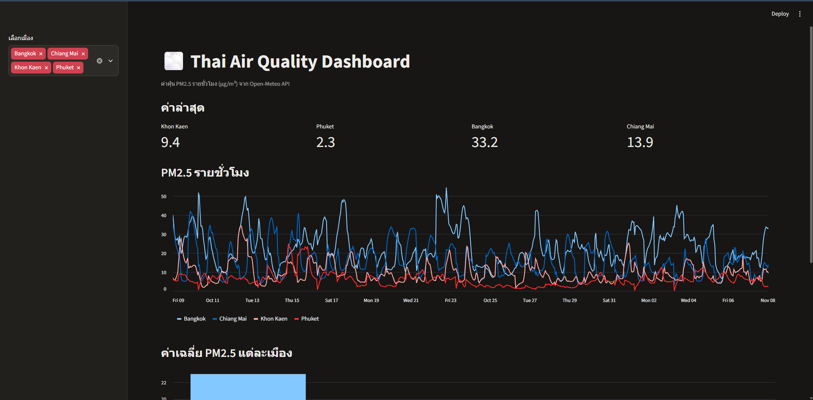

# Thai Air Quality Pipeline

ETL pipeline ที่ดึงข้อมูลค่าฝุ่น PM2.5 และ PM10 รายชั่วโมงของ 4 เมืองในไทย
(Bangkok, Chiang Mai, Khon Kaen, Phuket) จาก Open-Meteo API แล้วบันทึกลง PostgreSQL

## Dashboard



รัน dashboard: `streamlit run dashboard.py` แล้วเปิด http://localhost:8501

## Architecture

Open-Meteo API → Python (extract + transform ด้วย pandas) → PostgreSQL → SQL analysis
                         ↑
                  cron (ทุกชั่วโมง)

## Tech Stack
- Python 3, pandas, requests, psycopg2
- PostgreSQL
- Linux (Ubuntu on WSL2), cron

## Features
- **Idempotent load:** ใช้ `UNIQUE (city, measured_at)` ร่วมกับ `ON CONFLICT DO NOTHING` รันซ้ำได้โดยข้อมูลไม่ซ้ำ
- ตัดค่าพยากรณ์ล่วงหน้าออก เก็บเฉพาะค่าที่วัดแล้ว
- รันอัตโนมัติทุกชั่วโมงด้วย cron และเก็บ log

## How to Run
```bash
python3 -m venv .venv
source .venv/bin/activate
pip install -r requirements.txt
psql mydb -f sql/schema.sql
python etl.py
```

## Example Query
```sql
SELECT city, ROUND(AVG(pm2_5)::numeric, 1) AS avg_pm25
FROM air_quality GROUP BY city ORDER BY avg_pm25 DESC;
```

## Limitations & Next Steps
- cron ทำงานเฉพาะตอนที่ WSL เปิดอยู่
- แผนต่อไป: Docker Compose, Airflow, dashboard

## Architecture

```
Open-Meteo API → Python (extract + transform ด้วย pandas) → PostgreSQL → SQL analysis
                         ↑
                  cron (ทุกชั่วโมง)
```
